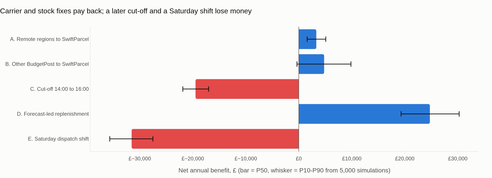
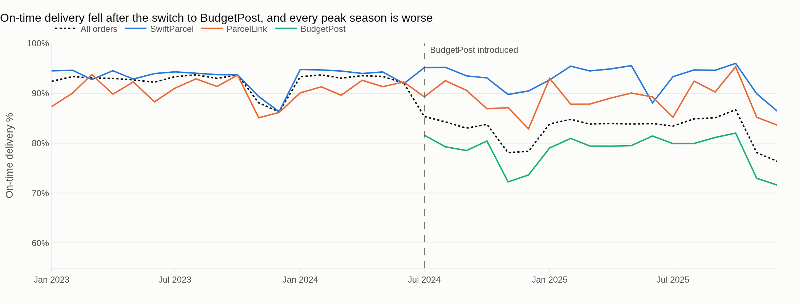
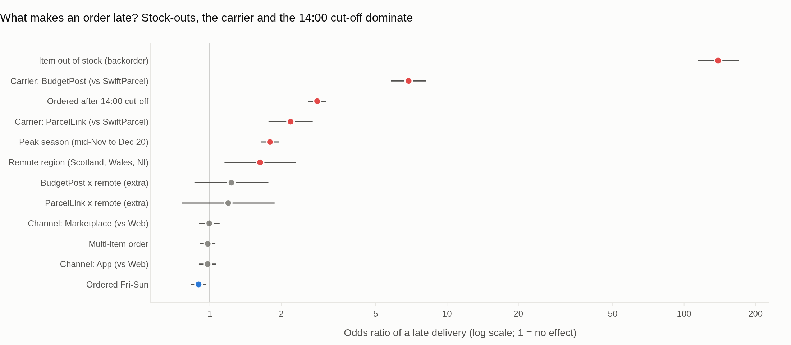
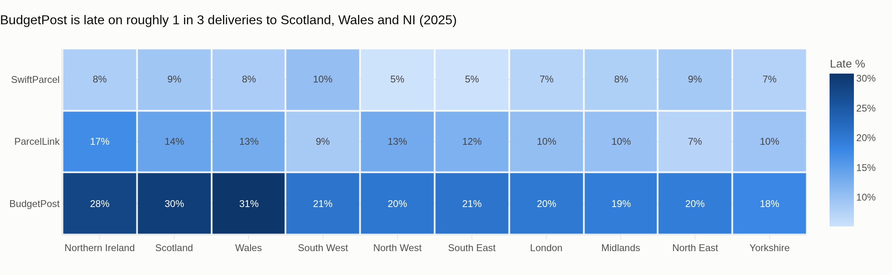
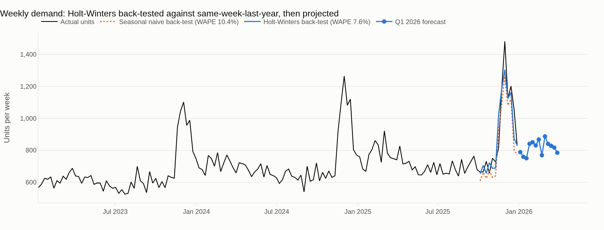

# Cheap Carrier, Expensive Customers
### A root-cause and cost-of-failure analysis of late deliveries for a UK e-commerce retailer


> **Client (fictional):** Northbrook Home, a UK online homeware retailer with ~19,000 orders and ~£2.8m revenue a year.
> **The brief:** *"Our on-time delivery has dropped and customer complaints are up. Why, what is it costing us, and what should we fix first?"*

All data is **simulated** (seeded, fully reproducible) from explicit business rules, with real-world data-quality problems injected on purpose. No real customer data is used.

---

## Executive summary

| | |
|---|---|
| **On-time delivery (OTD)** | fell from **91.7% (2023)** to **82.8% (2025)** |
| **Cost of late deliveries** | **£42k a year**, or **£13.32 per late order** (support contacts, vouchers, extra returns and lost repeat purchases) |
| **Root causes** | stock-outs (a backordered order is late ~90% of the time), the July 2024 switch to the cheap carrier **BudgetPost** (6.9x the odds of being late), and the 14:00 dispatch cut-off |
| **The carrier "saving" is false** | BudgetPost saves **£15k a year** in postage but causes **£23k a year** in late-delivery costs |
| **Recommended plan** | A + B + D below: OTD rises to **~94%** and **net benefit is ~£33k a year** (P10–P90: **£23k–£43k**), plus **~£125k of excess stock released** as one-off cash |
| **What not to do** | a Saturday dispatch shift **loses ~£30k a year**, and a later 16:00 cut-off **loses ~£18k a year** |

### Recommendations, ranked

| | Lever | Late orders avoided / yr | Annual cost | Net benefit / yr | Verdict |
|---|---|---:|---:|---:|---|
| **D** | Forecast-led replenishment (fewer stock-outs, release excess stock) | 414 | £5,000 | **+£25,600** | ✅ Do first |
| **B** | Move remaining BudgetPost volume to SwiftParcel | 1,291 | £12,540 | **+£4,650** | ✅ Do, or use as leverage to renegotiate BudgetPost's SLA |
| **A** | Route Scotland, Wales and NI from BudgetPost to SwiftParcel | 441 | £2,589 | **+£3,290** | ✅ Quick win (127% ROI) |
| **C** | Move dispatch cut-off from 14:00 to 16:00 | 133 | £20,240 | −£18,460 | ❌ Don't |
| **E** | Add a Saturday dispatch shift | 303 | £33,956 | −£29,920 | ❌ Don't |



---

## What the analysis found

**1. OTD broke when BudgetPost was introduced, and every peak season is worse.**


**2. Stock-outs, the carrier and the cut-off drive lateness; channel and basket size don't.**
Logistic regression on 27,000+ post-switch orders. Hold-out AUC is **0.81** (trained Jul-24 to Jun-25, tested Jul-25 to Dec-25).


**3. The carrier problem is concentrated in remote regions.** BudgetPost is late on nearly 1 in 3 deliveries to Wales, Scotland and Northern Ireland.


**4. Late delivery costs repeat business.** 41.6% of customers whose first order arrived on time came back, compared with 30.4% when it was late. That 11-point gap is the largest part of the cost of a late order.

**5. Better forecasting releases stock.** Holt-Winters beats the "same week last year" benchmark on a 13-week hold-out that includes peak (**WAPE 7.6% vs 10.4%**). Setting reorder targets from the forecast (4-week lead time, 2-week review cycle, 95% service level) shows ~£125k of stock above target, 43% of it in Furniture.


---

## Method

```
generate_data.py ─► clean.py ─► build_warehouse.py ─► run_queries.py (8 SQL questions)
   (simulated        (13 data-      (SQLite star          │
    raw exports)      quality rules)  schema)             ▼
                                              drivers_model.py ─► opportunity_sizing.py ─► dashboard.py
                                              forecast.py ───────┘   (£ per lever +         (HTML + PNG)
                                                                      Monte Carlo)
```

| Step | What it does | Why it matters to a client |
|---|---|---|
| **Data cleaning** | Fixes duplicates, inconsistent region and carrier labels, mixed ISO/UK date formats, impossible timestamps, invalid order values and missing scans. Every rule is logged in [`reports/data_quality_log.csv`](reports/data_quality_log.csv). | The numbers can be audited |
| **Star schema** | `fact_orders`, `fact_order_lines`, `fact_inventory` with date, customer, product, carrier and region dimensions | Ready for Power BI or any BI tool |
| **SQL** | 8 business questions in [`sql/business_queries.sql`](sql/business_queries.sql): OTD trend, carrier × region, cut-off effect, stock-outs, repeat rate, peak strain, cost vs service | Answers in the language the ops team uses |
| **Driver model** | Logistic regression with odds ratios and 95% CIs, plus a time-based hold-out test | Shows *how much* each factor matters, not just a score |
| **Opportunity sizing** | Counterfactual scoring: change one lever in the 2025 orders and predict the new late count. The Saturday shift is scored by replaying orders through the dispatch rules. | Turns findings into £ |
| **Monte Carlo** | 5,000 simulations drawing model coefficients and business assumptions from ranges, giving P10/P50/P90 | Shows how confident to be |
| **Forecast** | Holt-Winters (damped trend, multiplicative 52-week seasonality) vs seasonal-naive, back-tested on 13 weeks | Feeds the inventory targets |

All £ assumptions (carrier rates, support costs, margin, shift costs, holding cost) live in one file, [`src/config.py`](src/config.py), so any number can be challenged and the whole analysis re-run.

---

## Run it yourself

```bash
git clone https://github.com/gnanamahi/uk-ecommerce-fulfilment-analysis.git
cd uk-ecommerce-fulfilment-analysis
pip install -r requirements.txt
python run_all.py          # ~1 minute: data -> cleaning -> SQL -> model -> forecast -> £ -> dashboard
pytest -q                  # 11 tests
```

Then open **`reports/dashboard.html`** in a browser for the interactive dashboard with hover detail. A Power BI build guide is in [`docs/powerbi_guide.md`](docs/powerbi_guide.md).

## Repository structure

```
├── data/raw/                 simulated raw exports (with deliberate quality issues)
├── sql/business_queries.sql  8 business questions
├── src/
│   ├── config.py             paths + every business assumption
│   ├── generate_data.py      seeded data simulator
│   ├── clean.py              cleaning + data-quality log
│   ├── build_warehouse.py    SQLite star schema
│   ├── run_queries.py        runs the SQL, saves results
│   ├── drivers_model.py      logistic regression + hold-out AUC
│   ├── forecast.py           Holt-Winters vs seasonal naive
│   ├── opportunity_sizing.py £ per lever, inventory targets, Monte Carlo
│   └── dashboard.py          Plotly dashboard + README charts
├── reports/                  outputs: dashboard, figures, CSV results
├── docs/powerbi_guide.md
├── tests/test_pipeline.py
└── run_all.py
```

## Limitations and next steps

- **Simulated data.** The causes are built into the simulator, so this shows the *method* finds them; real data would be noisier.
- **Association, not proof.** The carrier effect is estimated from observational data. A difference-in-differences on the July 2024 switch, or a regional A/B carrier trial, would strengthen the causal claim.
- **Repeat-purchase gap** is measured on first orders and applied to all late orders, which is a simplification.
- **Next:** survival / BG-NBD customer-lifetime-value model; LightGBM + SHAP late-risk score at checkout; carrier allocation by region as a linear programme (PuLP); SKU-level forecasts with hierarchical reconciliation.

---

**Author:** GnanaMahi, MSc Business Analytics · [GitHub](https://github.com/gnanamahi)
